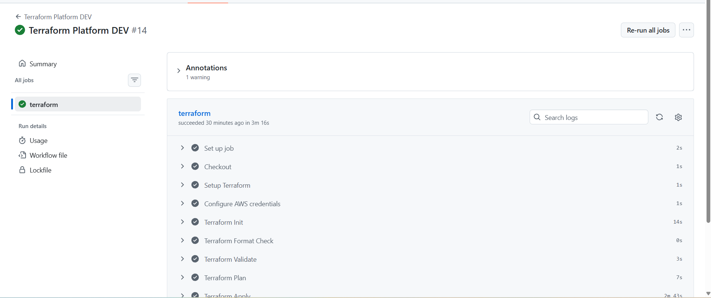
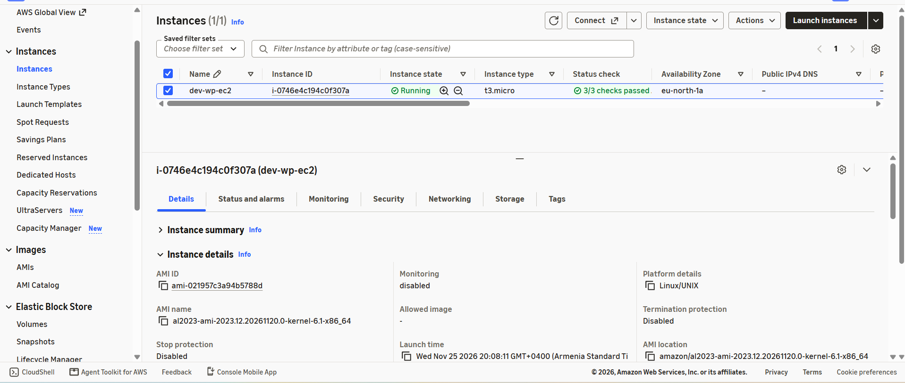
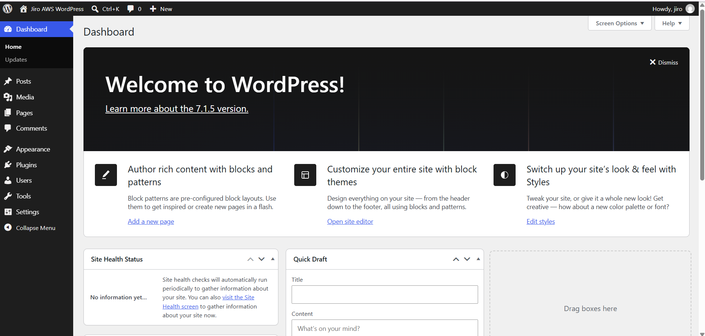

# AWS WordPress Infrastructure — Platform

## Project Overview

Terraform-based AWS infrastructure designed to support a scalable and secure WordPress application.

The project separates platform infrastructure from application resources and supports isolated DEV and PROD environments.

## Architecture

The platform provides the foundational infrastructure for the WordPress application:

- Amazon VPC
- Public and private subnets across Availability Zones
- Internet Gateway
- NAT Gateway
- Route tables
- AWS KMS encryption
- S3 remote Terraform state

## Technologies

| Technology | Purpose |
|---|---|
| AWS | Cloud infrastructure |
| Terraform | Infrastructure as Code |
| GitHub Actions | CI/CD automation |
| AWS IAM & OIDC | Secure authentication |
| Amazon S3 | Remote state storage |
| AWS KMS | Encryption |

## CI/CD Pipeline

GitHub Actions automates infrastructure management:

- Terraform Init
- Terraform Format Check
- Terraform Validate
- Terraform Plan
- Terraform Apply
- Terraform Destroy

AWS authentication is implemented using OpenID Connect (OIDC), eliminating the need for long-lived AWS access keys.

## Environment Strategy

- DEV — Development and infrastructure testing
- PROD — Separate production environment configuration

## Security

- Private network isolation
- IAM role-based authentication
- KMS encryption
- Remote Terraform state management

## Deployment Status

The DEV infrastructure was successfully deployed and tested on AWS in the eu-north-1 region.

The infrastructure was destroyed after successful testing to avoid unnecessary cloud costs.

Route 53 and ACM configurations are currently disabled.

## Related Repository

[WordPress Application Infrastructure](https://github.com/jiro-779/wordpress-app)

## Author

**Jirayr Hovsepyan**

Junior DevOps / Cloud Engineer

[GitHub Profile](https://github.com/jiro-779)

## Deployment Screenshots

### Successful Terraform Platform Deployment

### Running EC2 Instance

### WordPress Dashboard

